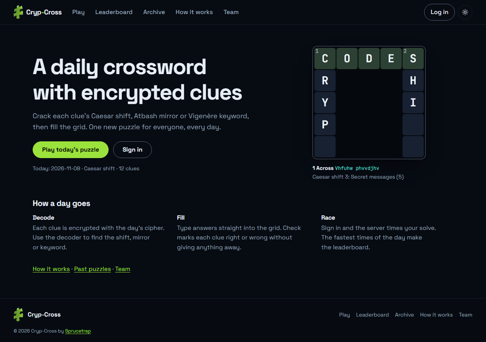
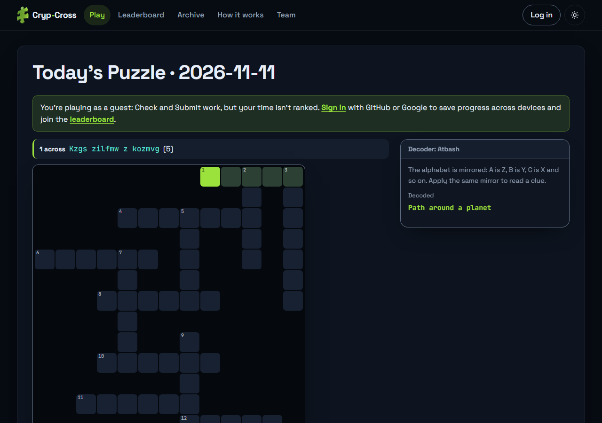
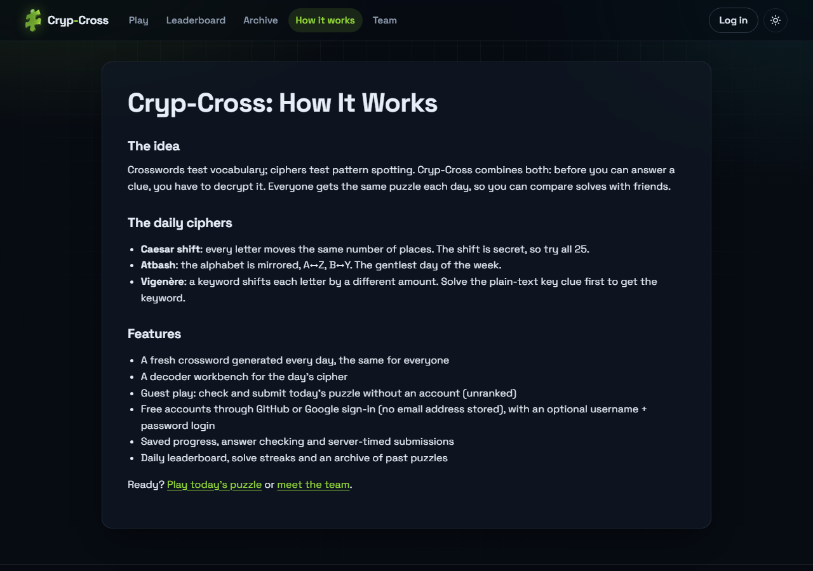
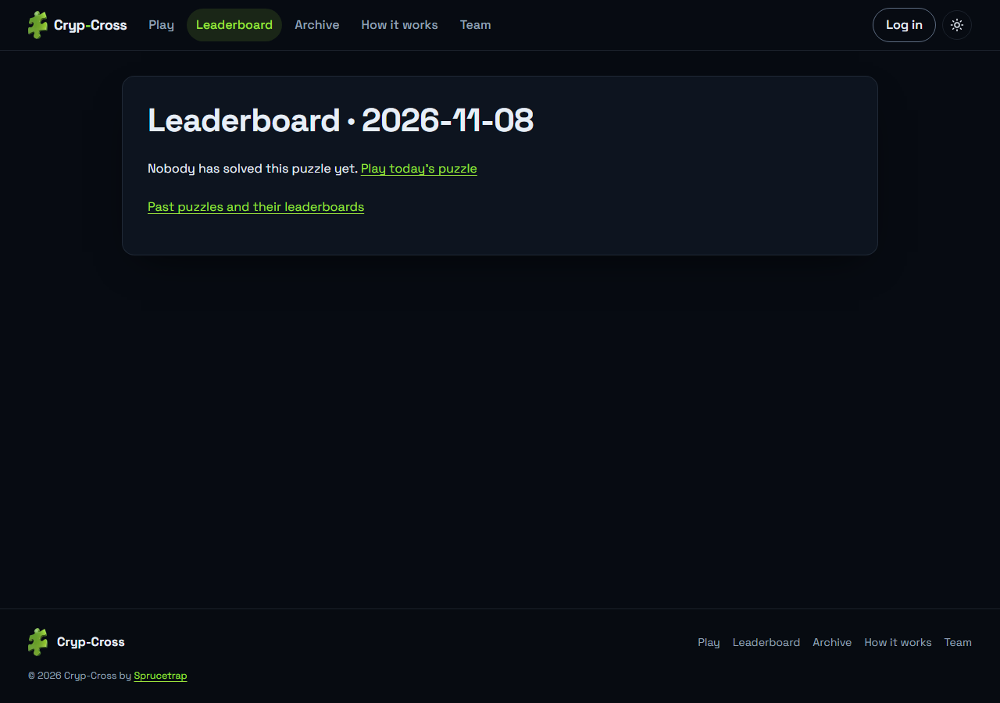
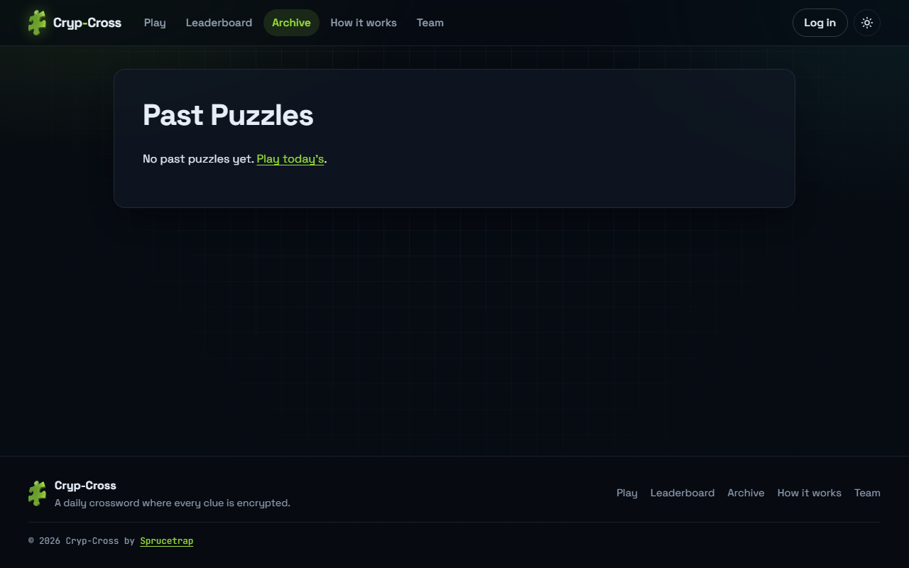
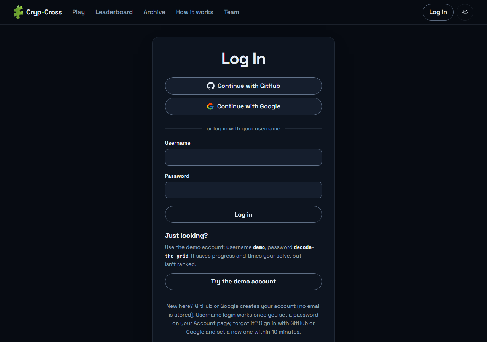
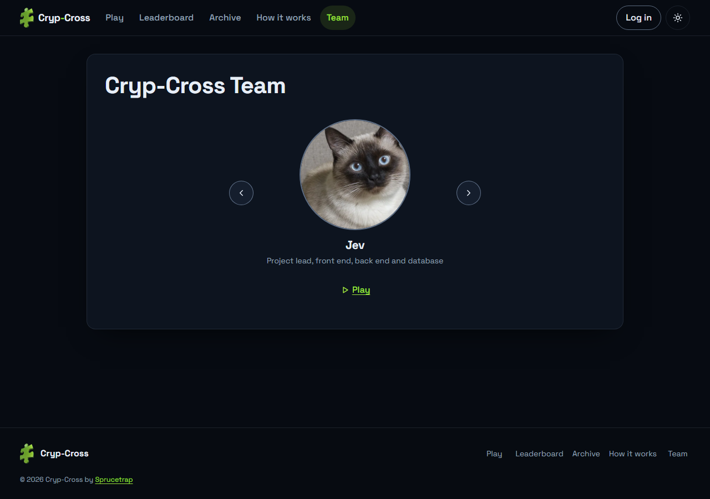
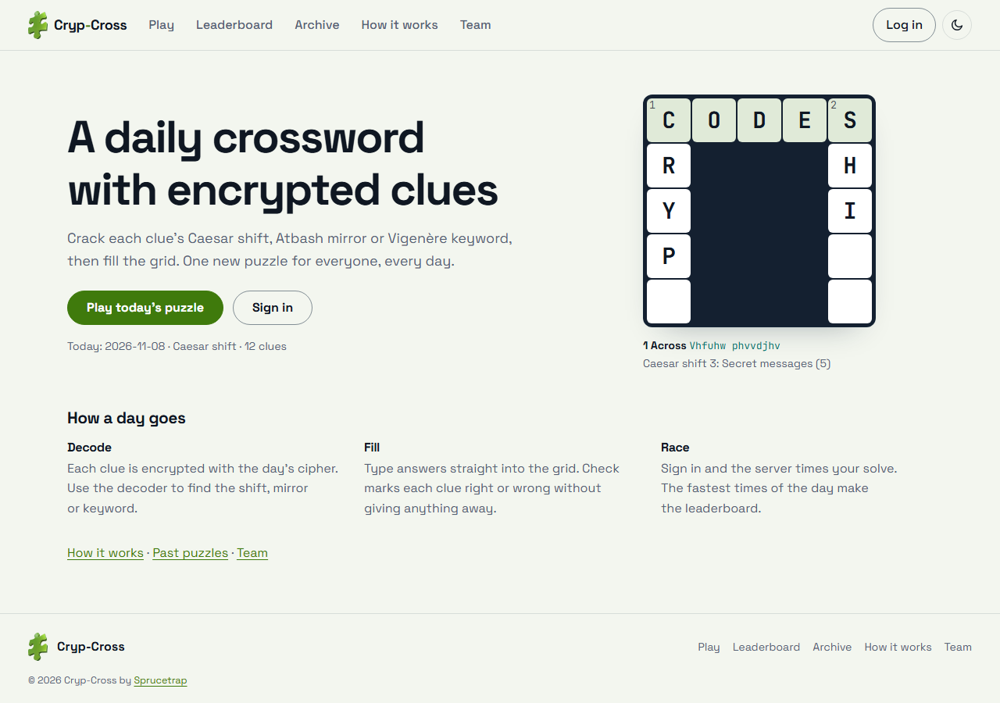
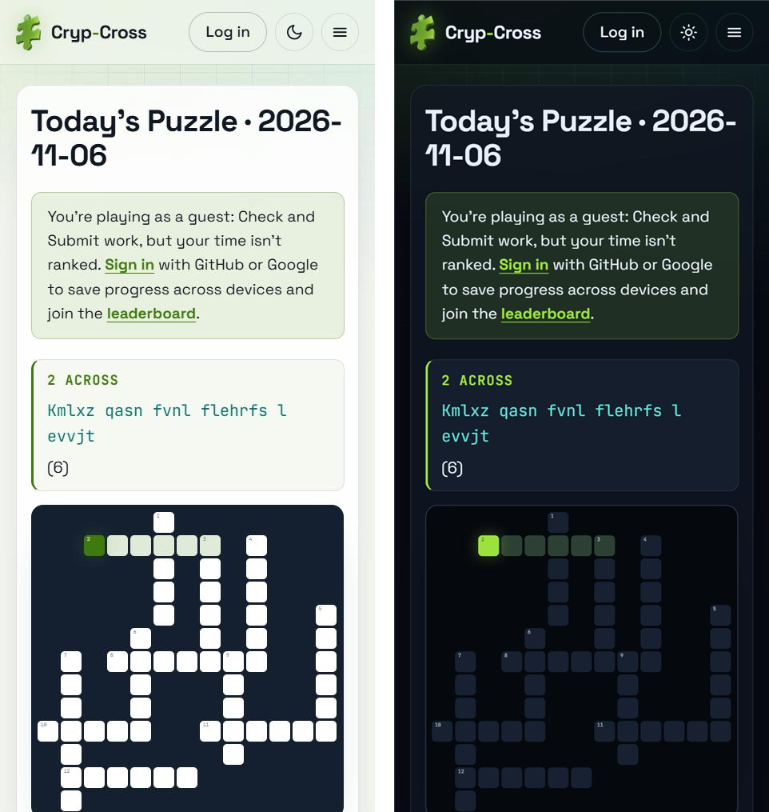
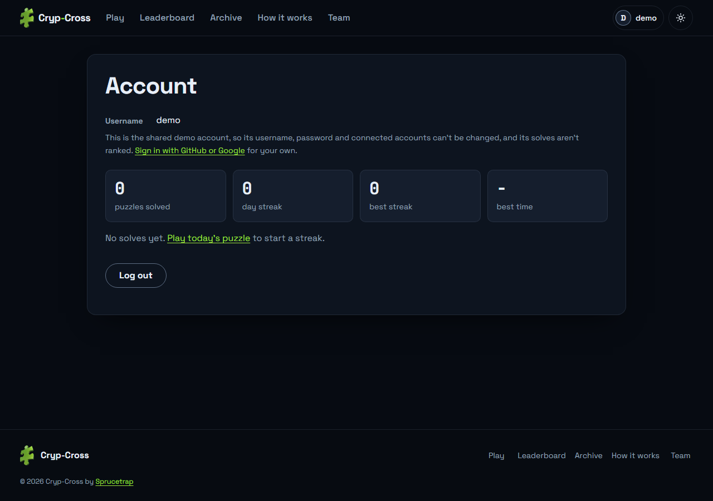

<a id="top"></a>

<div align="center">
  

  <h1>Cryp-Cross</h1>

  <p><strong>A daily cryptographic crossword: decode the encrypted clues, fill the grid, keep your streak.</strong></p>

  <p>
    
    <a href="LICENSE"></a>
    <a href="https://github.com/Jevoel16/Cryp-Cross/actions/workflows/ci.yml"></a>
    
  </p>
</div>

<p align="center">
  <a href="#about">About</a> · <a href="#screenshots">Screenshots</a> · <a href="#features">Features</a> · <a href="#tech-stack">Tech Stack</a> · <a href="#getting-started">Getting Started</a> · <a href="#configuration">Configuration</a> · <a href="#usage">Usage</a> · <a href="#more">More</a> · <a href="#contributing">Contributing</a> · <a href="#license">License</a> · <a href="#author">Author</a>
</p>

---

## About

Cryp-Cross is a free daily crossword where every clue is encrypted. Each day the server generates one grid for everyone and hides its clues behind a classical cipher (Caesar, Atbash or Vigenère). Players crack the cipher with a built-in decoder, fill the grid, and check and submit their answers. Guests play unranked; with a free account, solves are timed by the server and climb the leaderboard. It is a MERN app (MongoDB, Express, React, Node.js). Play it at [cryp-cross.jevoelorbilla.dev](https://cryp-cross.jevoelorbilla.dev) (the Log in page has a demo account), and read [why it is built this way](docs/decisions.md).

## Screenshots

<details>
<summary><b>Screenshots</b></summary>

<table>
  <tr>
    <td width="50%" align="center"><b>Home</b><br><a href="docs/images/home.png"></a></td>
    <td width="50%" align="center"><b>Play</b><br><a href="docs/images/play.png"></a></td>
  </tr>
  <tr>
    <td width="50%" align="center"><b>How it works</b><br><a href="docs/images/how-it-works.png"></a></td>
    <td width="50%" align="center"><b>Leaderboard</b><br><a href="docs/images/leaderboard.png"></a></td>
  </tr>
  <tr>
    <td width="50%" align="center"><b>Past puzzles</b><br><a href="docs/images/past-puzzles.png"></a></td>
    <td width="50%" align="center"><b>Log in</b><br><a href="docs/images/login.png"></a></td>
  </tr>
  <tr>
    <td width="50%" align="center"><b>Team</b><br><a href="docs/images/team.png"></a></td>
    <td width="50%" align="center"><b>Light mode</b><br><a href="docs/images/light-mode.png"></a></td>
  </tr>
  <tr>
    <td width="50%" align="center"><b>Phone (light and dark)</b><br><a href="docs/images/phone.png"></a></td>
    <td width="50%" align="center"><b>Account (demo)</b><br><a href="docs/images/account.png"></a></td>
  </tr>
</table>

</details>

## Features

- One new encrypted crossword for everyone, every day
- A built-in decoder for Caesar, Atbash and Vigenère clues
- Play as a guest, try the demo account, or sign in with GitHub or Google (no email stored)
- Progress saved as you type, with Check to mark right and wrong clues
- Server-timed solves on a daily leaderboard, plus streaks and stats
- An archive of past puzzles with their solutions and leaderboards
- Dark and light themes, keyboard and touch input, works on phones

Full list: [docs/features.md](docs/features.md).

## Tech Stack

| Layer | Tools |
|-------|-------|
| Frontend | React 19.2.0, React Router 7.18.5, Vite 8.3.5 |
| Tooling | Vitest 5.1.0, ESLint 10.14.0, Prettier 3.9.10 |
| Backend | Node.js 22.14.0, Express 4.22.3, Mongoose 7.8.13, express-session 1.19.0, connect-mongo 6.0.0, bcryptjs 3.0.3, helmet 8.3.0, express-rate-limit 7.5.1 |
| Database | MongoDB (Atlas in production, mongodb-memory-server for tests and local dev) |
| Hosting | Vercel (static site and serverless API on one origin), Vercel Analytics 2.0.1, GitHub Actions CI |

## Getting Started

Prerequisites: Node.js 22 (`.nvmrc`), npm and Git. No MongoDB is needed to try it.

```bash
git clone https://github.com/Jevoel16/Cryp-Cross.git && cd Cryp-Cross
npm install && npm install --prefix server
npm run dev:memory --prefix server   # API on :5000 with an in-memory database
npm start                            # in a second terminal: site on http://localhost:3000
```

With a real database, copy the Local block of `server/.env.example` into `server/.env`, set `DATABASE_URL`, and run `npm start --prefix server` instead. To deploy, see [docs/deployment.md](docs/deployment.md).

## Configuration

The API reads `server/.env` (template: [`server/.env.example`](server/.env.example)) and the frontend reads a root `.env` (template: [`.env.example`](.env.example); each has Local, Development and Production blocks). Signing in needs a GitHub or Google OAuth app; the setup steps are in [docs/configuration.md](docs/configuration.md).

<details>
<summary><b>Environment variables</b></summary>

| Variable | Where | Description |
|----------|-------|-------------|
| `DATABASE_URL` | API | MongoDB connection string (required) |
| `SESSION_SECRET` | API | Signs the session cookie (required in production) |
| `PUZZLE_SECRET` | API | Mixed into the puzzle seed so future puzzles can't be computed (required in production) |
| `APP_URL` | API | Public site URL, where sign-in returns to |
| `CORS_ORIGINS` | API | Comma-separated allowed frontend origins |
| `GITHUB_CLIENT_ID`, `GITHUB_CLIENT_SECRET` | API | Enables GitHub sign-in |
| `GOOGLE_CLIENT_ID`, `GOOGLE_CLIENT_SECRET` | API | Enables Google sign-in |
| `API_URL`, `PORT`, `TRUST_PROXY`, `NODE_ENV` | API | Hosting options |
| `PUZZLE_TZ`, `MIN_SOLVE_SECONDS`, `AUTH_RATE_LIMIT`, `OAUTH_RATE_LIMIT` | API | Puzzle day, minimum solve time and rate limits |
| `DEMO_ACCOUNT` | API | Shared demo account on the Log in page (`on` by default, `off` to disable) |
| `VITE_API_URL` | Frontend | API base URL when it is on another origin (empty means same origin) |
| `VITE_SITE_URL` | Frontend | Public site URL for canonical links and `sitemap.xml` |

Defaults and details: [docs/configuration.md](docs/configuration.md).

</details>

## Usage

1. Open **Play** (`/play`). The decoder names today's cipher.
2. Pick a clue and decode it: move the Caesar slider, read the Atbash output, or solve the Vigenère key clue and type the keyword.
3. Type the answer. Tab or Enter jumps to the next clue.
4. **Check** marks each clue right or wrong. **Submit** records your time once the grid is full.
5. Sign in with GitHub or Google before you start to save progress and get ranked on the **Leaderboard**.

More: [player and account flows](docs/usage.md), [API reference](docs/api.md), [architecture notes](docs/architecture.md), [state machines](docs/state-machines.md), [security](docs/security.md), [performance](docs/performance.md), [deployment](docs/deployment.md), [troubleshooting](docs/troubleshooting.md).

## More

<details>
<summary><b>Project structure</b></summary>

```
Cryp-Cross/
├── .github/workflows/   # CI
├── api/                 # Vercel serverless entry for the Express app
├── docs/                # Guides and README screenshots
├── public/              # Static files: icons, theme script, robots.txt, llms.txt
├── scripts/             # Post-build sitemap and robots.txt generator
├── server/              # Express API, puzzle generator, models, tests
└── src/                 # React app: pages, components, hooks, ciphers
```

</details>

<details>
<summary><b>Scripts</b></summary>

| Script | Description |
|--------|-------------|
| `npm start` | Vite dev server on port 3000 (proxies `/api` to port 5000) |
| `npm run build` | Production build into `build/`, plus `sitemap.xml` and `robots.txt` |
| `npm run serve` | Serve `build/` with the `serve.json` headers |
| `npm run lint` / `npm run format` | ESLint / Prettier |
| `npm test` | Vitest unit tests |
| `npm start --prefix server` | Start the API |
| `npm run dev:memory --prefix server` | Start the API on a throwaway in-memory MongoDB |
| `npm test --prefix server` | Backend tests |

</details>

## Contributing

Branches: `feat/short-description` or `fix/short-description`. Commits follow [Conventional Commits](https://www.conventionalcommits.org/) e.g. `feat: add CSV export`. The SemVer version is bumped once per release (`chore: release vX.Y.Z` plus a tag), not per commit. Update this README with every change. SEO ideas: [docs/backlinks.md](docs/backlinks.md).

## License

[Sprucetrap Source-Available License 1.0](LICENSE): non-commercial use with visible credit; commercial use needs written permission.

## Author

**Sprucetrap** ([@Jevoel16](https://github.com/Jevoel16)), for CCC181 Lab Activity Final (Orbilla team).

<p align="right"><a href="#top">Back to top</a></p>
